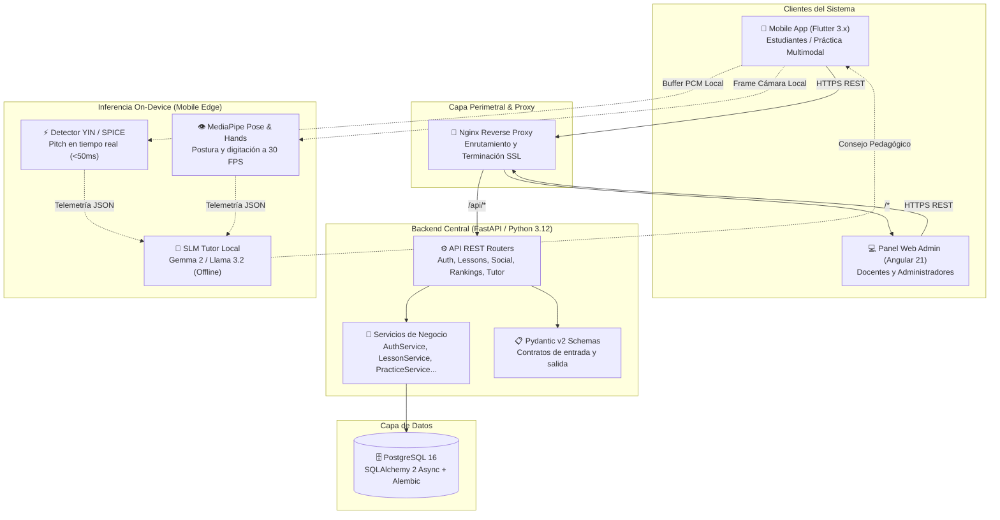

# Arquitectura de Software — Aliento Andino

> **Modelo**: Vistas 4+1 de Kruchten, Modelo C4 & Clean Architecture.  
> **Versión documentada**: v1.0 (Refactorización a Tutor de Viento Andino).  
> **Alcance**: Plataforma integral interactiva para la enseñanza de **instrumentos de viento andinos** (Quena, Zampoña y Tarka), con inferencia multimodal 100% on-device, backend asíncrono, panel administrativo web y aplicación móvil de alta fidelidad.  
> **Modelo C4 Detallado**: Consultar [`C4_MODEL.md`](C4_MODEL.md) para los diagramas formales de Contexto, Contenedores, Componentes y Código.

---

## 1. Vista de Casos de Uso

Los casos de uso del sistema nacen de los Requerimientos Funcionales (RF-01 a RF-06) del dominio de viento andino y las normas de calidad especificadas en [`docs/QUALITY_STANDARDS.md`](QUALITY_STANDARDS.md) y [`docs/C4_MODEL.md`](C4_MODEL.md). Para la planificación ágil completa, el desglose de Historias de Usuario y los issues de GitHub vinculados, consultar [`docs/SPRINTS_AND_USER_STORIES.md`](SPRINTS_AND_USER_STORIES.md). Estos requerimientos condicionan las decisiones arquitectónicas fundamentales:

| Requisito / HU                                        | Decisión Arquitectónica que Impone                                                                                                    |
| :---------------------------------------------------- | :------------------------------------------------------------------------------------------------------------------------------------ |
| **RF-01 / HU-01 Práctica y Afinación en Tiempo Real** | Motor acústico híbrido local: YIN optimizado para baja latencia ($<50\text{ms}$) + SPICE para precisión armónica.                     |
| **RF-02 / HU-03 Detección Postural y Embocadura**     | MediaPipe Pose + Hands procesando a $\ge 24\text{ FPS}$ en GPU/NPU del dispositivo móvil. Cero streaming de video a la nube.          |
| **RF-03 / HU-05 Feedback Pedagógico del Tutor**       | Telemetría compacta en JSON inyectada a un SLM local (Gemma 2 2B / Llama 3.2 1B-3B vía MediaPipe LLM Inference / WebLLM).             |
| **RF-04 / HU-09 Red Social y Muro Comunitario**       | Capa relacional en PostgreSQL 16 con índices de alto rendimiento (`a1b2c3d4e5f6_add_performance_indexes.py`) y paginación por cursor. |
| **RF-05 / HU-13 Gamificación y Desafíos Semanales**   | Máquina de estados de rachas (`streak_freezes`) y cálculo asíncrono de puntuaciones y rankings en FastAPI.                            |
| **RF-06 / HU-17 Gestión Curricular y Panel Docente**  | Panel web en Angular 21 (Standalone + Signals) con control de acceso basado en roles (RBAC) y exportación analítica.                  |

---

## 2. Vista Lógica

### 2.1 Subsistemas y Flujos de Comunicación



### 2.2 Principio de Desacoplamiento de Inferencia de IA

El diseño arquitectónico prohíbe de forma estricta enviar audio o video crudos al backend o a APIs de terceros:

1. El dispositivo móvil captura audio a 44.1 kHz y video a 30 FPS.
2. Los modelos on-device (YIN/SPICE y MediaPipe) extraen variables discretas (cents de desviación, nota detectada, ángulo de codos, oclusión de orificios).
3. Los resultados se sintetizan en un paquete de telemetría liviano (`PracticeResultSchema`).
4. Únicamente la telemetría agregada y el puntaje final se transmiten al backend para persistencia y sincronización social.

---

## 3. Vista de Implementación

### 3.1 Estructura del Monorepo

```text
aliento-andino/
├── apps/                      # Monorepo de aplicaciones y servicios (pnpm workspace)
│   ├── backend/               # Microservicio API REST en Python 3.12 (FastAPI)
│   │   ├── alembic/           # Control de versiones del esquema relacional
│   │   ├── app/               # Routers, services, models y schemas
│   │   └── Dockerfile         # Imagen multi-stage para backend
│   ├── web/                   # Aplicación Web Admin (Angular 21 Standalone + Signals)
│   │   ├── src/app/           # Módulos por dominio, servicios core y shared
│   │   └── Dockerfile         # Compilación Angular + Nginx estático
│   ├── mobile/                # Aplicación Móvil en Flutter 3.x (On-Device Edge AI)
│   │   ├── lib/               # BLoC, inferencia YIN/SPICE, MediaPipe y UI
│   │   └── Dockerfile         # Contenedor para CI / Flutter Web
│   ├── ml/                    # Inferencia acústica y asistente semántico offline
│   │   ├── server.py          # Microservicio FastAPI ML en puerto 8001
│   │   └── Dockerfile         # Contenedor Python 3.12 ML
│   └── docs/                  # Manual de usuario oficial (Docusaurus 3)
│       ├── docs/              # Guías para alumnos, docentes y calibración
│       └── Dockerfile         # Servidor Nginx estático en puerto 3001
├── infra/                     # Infraestructura perimetral y scripts de despliegue
│   ├── nginx/                 # Reverse proxy perimetral (rate-limiting y SSL)
│   ├── backup/                # Scripts y timers de backup automatizado a Object Storage
│   ├── docker-compose.yml     # Compose de producción multi-servicio
│   └── DEPLOYMENT_GUIDE.md    # Guía de despliegue dual (VPS vs Multi-Cloud)
├── docs/                      # Arquitectura (ARCHITECTURE.md), calidad y estándares de código
├── DESIGN.md                  # Tokens de diseño globales (apps/web/DESIGN.md y apps/mobile/DESIGN.md)
├── scripts/                   # Scripts de verificación y CI (ai-attribution.mjs)
├── docker-compose.yml         # Compose unificado de desarrollo local
└── package.json               # Scripts centrales de gestión monorepo (pnpm dev)
```

### 3.2 Patrón de Capas en Backend

```text
HTTP Request ──► Router (FastAPI)
                     │ (valida Pydantic Schema)
                     ▼
                 Service (Lógica de Negocio)
                     │ (orquesta transacciones)
                     ▼
                 Model (SQLAlchemy ORM) ──► PostgreSQL 16
```

---

## 4. Vista de Procesos y Concurrencia

1. **Backend Asíncrono:** Todas las rutas y accesos a datos operan sobre `async/await` mediante `asyncpg`. Las operaciones de base de datos no bloquean el event loop de Uvicorn.
2. **Ciclo de Inferencia Acústica Móvil:**
   - Hilo 1 (Audio Stream): Buffer circular de 1024 muestras.
   - Hilo 2 (Detección YIN / C++ isolate): Extracción de frecuencia fundamental cada $20\text{ms}$.
   - Hilo 3 (Renderizado UI): Actualización de la aguja de afinación y digitación en pantalla a 60 FPS sin tirones.
3. **Manejo de Estados en Frontend:**
   - Web: Angular Signals (`signal`, `computed`) para sincronización reactiva inmediata sin sobrecarga de Change Detection de Zone.js.
   - Mobile: BLoC (`flutter_bloc`) para gestionar transiciones de estado inmutables con tolerancia a desconexión.

---

## 5. Vista de Despliegue

La infraestructura del proyecto es **Cloud-Agnostic** y adaptable a dos topologías principales documentadas en detalle en [`../infra/DEPLOYMENT_GUIDE.md`](../infra/DEPLOYMENT_GUIDE.md):

### 5.1 Entorno Canónico de Desarrollo

El entorno completo se orquesta centralizadamente desde la raíz:

```bash
# Iniciar todos los servicios contenerizados (db, backend, web, docs, ml, nginx)
pnpm dev

# O iniciar servicios individualmente
pnpm docker:backend
pnpm docker:web
pnpm docker:docs
```

- **Backend:** Puerto `8000` (FastAPI).
- **PostgreSQL:** Puerto `5432` con volumen persistente `pgdata`.
- **Web Admin:** Puerto `4200` (Angular 21).
- **Manual de Usuario:** Puerto `3001` (Docusaurus).
- **Microservicio ML:** Puerto `8001` (Inferencia y FAQ semántico).
- **Reverse Proxy:** Puerto `80` (Nginx unificado).

### 5.2 Despliegue en Producción

1. **Topología A (Monolítica VPS)**: Despliegue integral con `infra/docker-compose.yml` en un único servidor (DigitalOcean / Hetzner), asegurado con Nginx perimetral y Certbot SSL.
2. **Topología B (Distribuida Multi-Cloud / Serverless)**:
   - **Web Admin**: Cloudflare Pages / Vercel.
   - **Manual de Usuario**: GitHub Pages vía `.github/workflows/docs.yml`.
   - **Backend**: Render / Google Cloud Run / Railway.
   - **Database**: Neon Serverless Postgres / Supabase.
   - **ML Service**: Render / RunPod Serverless.
   - **Mobile**: Google Play Store y Apple App Store.

---

## 6. Decisiones de Diseño y Trade-offs

| Decisión                                      | Justificación                                                                                                                     | Alternativa Descartada                                                                                           |
| :-------------------------------------------- | :-------------------------------------------------------------------------------------------------------------------------------- | :--------------------------------------------------------------------------------------------------------------- |
| **Inferencia On-Device vs APIs de Nube**      | Garantiza latencia $<50\text{ms}$ indispensable para la retroalimentación de notas musicales y elimina costos recurrentes de API. | Enviar streams a Whisper / Gemini / OpenAI en la nube (latencia inaceptable $>1.5\text{s}$ y costo prohibitivo). |
| **FastAPI + SQLAlchemy 2 vs Django**          | Rendimiento asíncrono superior para telemetría concurrente y serialización nativa con Pydantic v2.                                | Django REST Framework (mayor sobrecarga síncrona).                                                               |
| **Flutter BLoC vs Riverpod**                  | Predictibilidad y trazabilidad formal de eventos y estados, indispensable para auditoría pedagógica.                              | Manejo de estado ad-hoc en StatefulWidgets.                                                                      |
| **Angular Signals vs Observables RxJS puros** | Menor complejidad sintáctica, reactividad fina y mejor rendimiento en Angular 21.                                                 | Arquitectura basada exclusivamente en pipes RxJS.                                                                |
