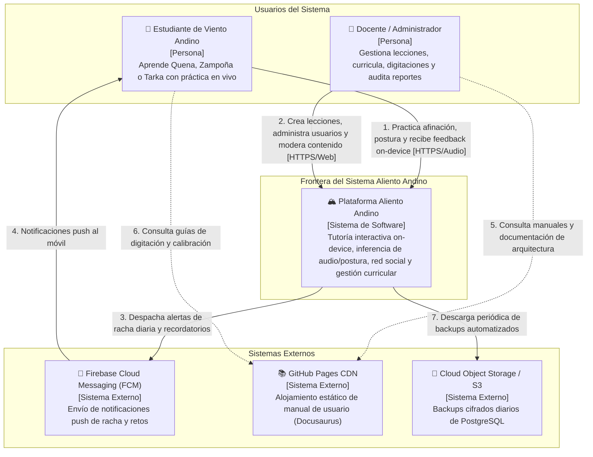
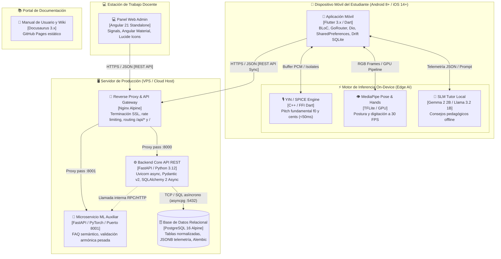
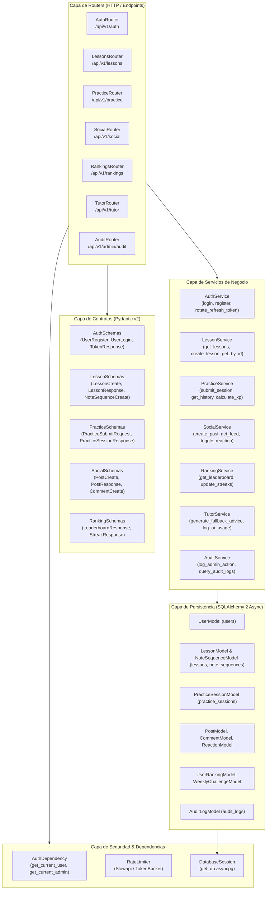
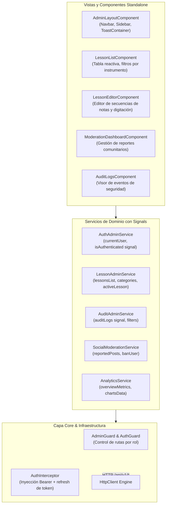
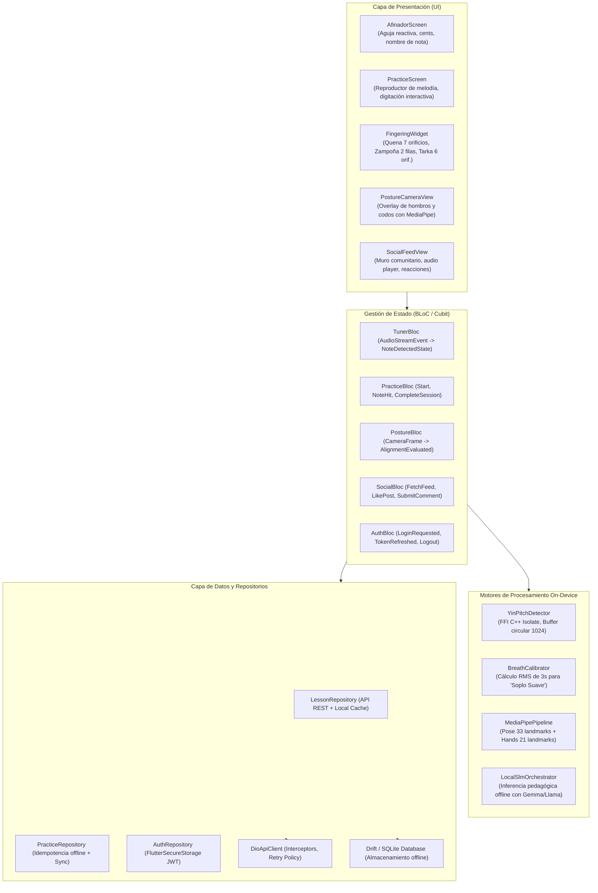
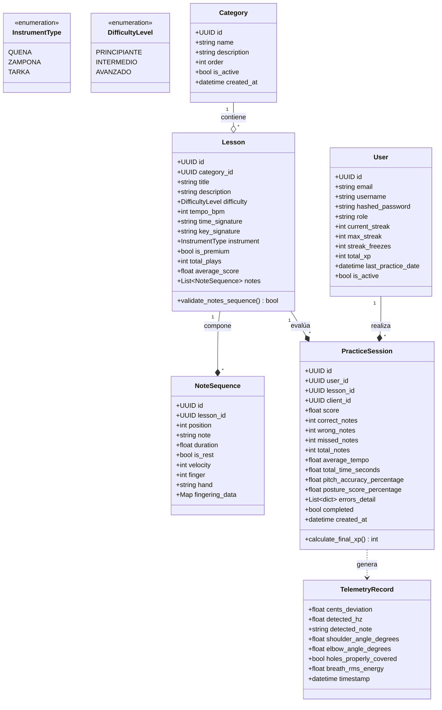
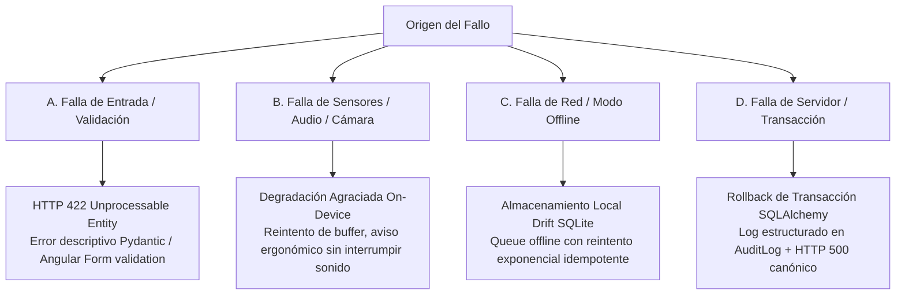

# Modelo C4 de Arquitectura de Software — Aliento Andino

> **Sistema**: Plataforma de Tutoría Virtual y Red Social para Instrumentos de Viento Andinos (Quena, Zampoña y Tarka).  
> **Estándar**: C4 Model (Context, Containers, Components, Code) por Simon Brown.  
> **Trazabilidad**: Enlazado con [`ARCHITECTURE.md`](ARCHITECTURE.md), [`SPRINTS_AND_USER_STORIES.md`](SPRINTS_AND_USER_STORIES.md), [`QUALITY_STANDARDS.md`](QUALITY_STANDARDS.md), [`CODING_STANDARDS.md`](CODING_STANDARDS.md) y tokens en [`../DESIGN.md`](../DESIGN.md).

---

## 1. Nivel 1: Diagrama de Contexto del Sistema (System Context)

El diagrama de contexto ubica a **Aliento Andino** dentro de su ecosistema operativo, delimitando a los usuarios y los sistemas externos con los que se relaciona.

### Descripción de Elementos de Contexto

| Elemento                        | Tipo                | Descripción                                                                                                                 |
| :------------------------------ | :------------------ | :-------------------------------------------------------------------------------------------------------------------------- |
| **Estudiante de Viento Andino** | Persona             | Usuario móvil que interpreta Quena, Zampoña o Tarka frente al micrófono y cámara.                                           |
| **Docente / Administrador**     | Persona             | Usuario del panel web encargado de la curaduría pedagógica y moderación comunitaria.                                        |
| **Plataforma Aliento Andino**   | Sistema de Software | Núcleo integral que procesa la telemetría, autentica usuarios, almacena progreso y brinda tutoría interactiva.              |
| **Firebase Cloud Messaging**    | Sistema Externo     | Servicio de mensajería para alertas de inactividad, preservación de racha (_Streak Flame_) y retos semanales.               |
| **GitHub Pages CDN**            | Sistema Externo     | Red de distribución de contenido que aloja el portal Docusaurus con manuales y especificaciones técnicas.                   |
| **Cloud Object Storage**        | Sistema Externo     | Repositorio de almacenamiento de objetos donde se depositan los backups comprimidos (`pg_dump`) generados por scripts cron. |

---

## 2. Nivel 2: Diagrama de Contenedores (Containers)

El diagrama de contenedores describe las aplicaciones, almacenes de datos y microservicios que componen **Aliento Andino**, indicando protocolos de comunicación y límites tecnológicos.

### Especificación de Contenedores

| Contenedor           | Tecnología                     | Responsabilidad                                                                                             | Protocolos                      |
| :------------------- | :----------------------------- | :---------------------------------------------------------------------------------------------------------- | :------------------------------ |
| **Mobile App**       | Flutter 3.x (Dart)             | Interfaz de práctica, captura de audio/video, orquestación de feedback, sincronización offline.             | HTTPS (REST), FFI a C++         |
| **Motor On-Device**  | C++, TFLite, MediaPipe, WebLLM | Detección de pitch $<50\text{ms}$, visión a 30 FPS y generación de consejos con 0 bytes enviados a la nube. | En memoria (Pointers / JSON)    |
| **Web Admin**        | Angular 21 Standalone          | Panel administrativo para gestión curricular de notas/digitaciones, estadísticas de uso y moderación.       | HTTPS (REST/JSON)               |
| **Reverse Proxy**    | Nginx Alpine                   | Gateway perimetral, balanceador de carga local, terminación SSL, rate limiting contra abusos (DDoS).        | HTTP/1.1, HTTPS (TLS 1.3)       |
| **Backend API**      | FastAPI / Python 3.12          | Autenticación JWT rotativa, lógica de negocio de lecciones, evaluación de rachas, rankings y muro social.   | HTTPS / REST / asyncpg          |
| **Microservicio ML** | FastAPI / Python 3.12 (8001)   | Motor complementario de embeddings semánticos para FAQ musical y validaciones armónicas complejas.          | HTTP / REST                     |
| **Base de Datos**    | PostgreSQL 16 Alpine           | Persistencia de usuarios, secuencias de notas, intentos de práctica, auditoría y relaciones sociales.       | PostgreSQL Wire Protocol (5432) |
| **Docs Site**        | Docusaurus 3 (pnpm)            | Wiki técnica y manual de usuario desplegado en GitHub Pages.                                                | HTTPS estático CDN              |

---

## 3. Nivel 3: Diagramas de Componentes (Components)

### 3.1 Componentes de Backend Core API (`apps/backend`)

El backend sigue una arquitectura en capas estrictamente desacoplada: **Routers $\rightarrow$ Services $\rightarrow$ Models / Database**.

### 3.2 Componentes de la Aplicación Web Admin (`apps/web`)

Desarrollada en Angular 21 con arquitectura Standalone, Signals y control de acceso RBAC.

### 3.3 Componentes de la Aplicación Móvil (`apps/mobile`)

Estructurada en Flutter 3.x con Clean Architecture, BLoC reactivo e inferencia local desacoplada.

---

## 4. Nivel 4: Diagrama de Código y Clases Clave (Code Level)

Para asegurar la **continuidad arquitectónica estricta** y erradicar cualquier discrepancia de nombres (como `gastosPago()` vs `gastosTotalPagar()`), se formalizan los contratos de clases y modelos del dominio:

---

## 5. Matriz de Continuidad de Nomenclatura y Contratos Unificados

Para cumplir con la directriz de **tolerancia cero a discrepancias de nombres**, la siguiente tabla define el estándar canónico en todas las capas tecnológicas:

| Concepto de Negocio       | Campo en Base de Datos (SQL) | Schema Backend (Pydantic)                     | DTO Web Admin (TypeScript)                    | Modelo Mobile (Dart)                                |
| :------------------------ | :--------------------------- | :-------------------------------------------- | :-------------------------------------------- | :-------------------------------------------------- |
| **Identificador Lección** | `id` (UUID)                  | `id: UUID`                                    | `id: string`                                  | `String id`                                         |
| **Categoría Asignada**    | `category_id` (UUID)         | `category_id: UUID`                           | `category_id: string`                         | `String categoryId` (con `@JsonKey('category_id')`) |
| **Tempo en BPM**          | `tempo_bpm` (INTEGER)        | `tempo_bpm: int`                              | `tempo_bpm: number`                           | `int tempoBpm`                                      |
| **Instrumento Andino**    | `instrument` (VARCHAR)       | `instrument: str` (`quena`/`zampona`/`tarka`) | `instrument: 'quena' \| 'zampona' \| 'tarka'` | `InstrumentType instrument`                         |
| **Desviación en Cents**   | N/A (Telemetría JSONB)       | `cents_deviation: float`                      | `cents_deviation: number`                     | `double centsDeviation`                             |
| **Energía de Soplo**      | N/A (Config Local)           | `breath_rms_energy: float`                    | N/A                                           | `double breathRmsEnergy`                            |
| **Secuencia de Notas**    | `note_sequences` (Tabla)     | `notes: list[NoteSequenceResponse]`           | `notes: NoteSequence[]`                       | `List<NoteSequenceModel> notes`                     |
| **Idempotencia Cliente**  | `client_id` (UUID único)     | `client_id: UUID \| None`                     | N/A                                           | `String clientId`                                   |
| **Racha de Días**         | `current_streak` (INTEGER)   | `current_streak: int`                         | `current_streak: number`                      | `int currentStreak`                                 |
| **Congeladores Racha**    | `streak_freezes` (INTEGER)   | `streak_freezes: int`                         | `streak_freezes: number`                      | `int streakFreezes`                                 |

### Regla Canónica de Métodos por Capa

- **Obtener lista de lecciones**:
  - Backend Endpoint: `GET /api/v1/lessons` $\rightarrow$ Service: `LessonService.get_lessons()`
  - Web Service: `LessonAdminService.getLessons()`
  - Mobile Repository: `LessonRepository.getLessons()`
- **Registrar sesión de práctica**:
  - Backend Endpoint: `POST /api/v1/practice/session` $\rightarrow$ Service: `PracticeService.submit_practice_session()`
  - Mobile Repository: `PracticeRepository.submitPracticeSession()`
- **Calibrar soplo suave**:
  - Mobile Engine: `BreathCalibrator.calibrateSoftBreath()`
- **Detectar frecuencia fundamental**:
  - Mobile C++ Engine: `YinDetector_DetectPitch()` $\rightarrow$ Dart Wrapper: `YinPitchDetector.detectFundamentalFrequency()`

---

## 6. Estrategia de Manejo de Errores y Fallos en la Arquitectura

La arquitectura implementa patrones explícitos de resiliencia y manejo de excepciones en cada componente:

1. **Errores de Validación (422 / 400)**: Respuestas estándar con clave `detail` conteniendo el campo exacto y el mensaje en español neutro.
2. **Caída de Red / Modo Avión**: La app móvil detecta pérdida de enlace mediante `ConnectivityService`. La práctica no se interrumpe porque YIN y MediaPipe operan localmente. El resultado se encola en SQLite local con `client_id` autogenerado y se sincroniza al recuperar conexión.
3. **Ruido Acústico o Desconexión de Micrófono**: Si el umbral de energía RMS es inferior a la calibración de "Soplo Suave", el motor ignora el frame en lugar de emitir falsas desafinaciones.
4. **Pérdida de Landmark Postural**: Si la confianza de MediaPipe cae por debajo de 0.5 (iluminación baja o usuario fuera de cuadro), la evaluación postural se suspende temporalmente sin degradar la evaluación de afinación de audio.
