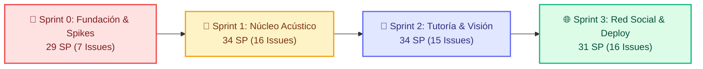

# Sprints e Historias de Usuario (HU) — Aliento Andino

> **Planificación Ágil, Desglose de Historias de Usuario y Trazabilidad a Issues de GitHub.**  
> Este documento formaliza el backlog ágil del proyecto **Aliento Andino**, organizado bajo la metodología **Scrum** y ejecutado mediante **Organic Driven Development (ODD)** en **Sprint 0 + 3 Sprints**.  
> Cada tarea, spike técnico, Historia de Usuario (Issue Madre) y Sub-issue técnico está vinculado bidireccionalmente a su correspondiente **Issue de GitHub** en el repositorio oficial [`moises-cisneros/aliento-andino`](https://github.com/moises-cisneros/aliento-andino/issues).

---

## 1. Visión General del Ciclo Ágil y Story Points

El desarrollo se articula en 4 iteraciones orientadas a incrementos de producto desplegables, totalizando **128 Story Points (SP)** distribuidos entre tareas fundacionales, desarrollo de interfaz móvil y web, microservicios, algoritmos acústico-posturales locales e infraestructura:



### Resumen de Distribución de Sprints

| Sprint       | Foco Principal                                                             | Story Points | Issues Madres / Spikes | Sub-issues Técnicos | Total Issues  |
| :----------- | :------------------------------------------------------------------------- | :----------: | :--------------------: | :-----------------: | :-----------: |
| **Sprint 0** | Harness monorepo, Docker, CI/CD, Spikes IA (YIN/MediaPipe) y Docusaurus    |    29 SP     |        7 chores        |          -          |   7 issues    |
| **Sprint 1** | Motor acústico YIN, afinador en tiempo real, digitaciones y panel docente  |    34 SP     |         5 HUs          |    11 sub-issues    |   16 issues   |
| **Sprint 2** | MediaPipe Pose & Hands, agente tutor SLM on-device, telemetría e historial |    34 SP     |         5 HUs          |    10 sub-issues    |   15 issues   |
| **Sprint 3** | Red social comunitaria, rankings semanales, gamificación, wiki y deploy    |    31 SP     |         6 HUs          |    10 sub-issues    |   16 issues   |
| **Total**    | **Ciclo Completo Aliento Andino**                                          |  **128 SP**  |  **23 HUs / Chores**   |  **31 Sub-issues**  | **54 Issues** |

---

## 2. Matriz Consolidada de Trazabilidad de Issues

Esta tabla resume todos los ítems de trabajo del proyecto y enlaza directamente con los issues abiertos en GitHub:

| ID         | Issue GitHub                                                                                                                             | Tipo / Rol  | Área      | SP  | Milestone / Sprint | Dependencia |
| :--------- | :--------------------------------------------------------------------------------------------------------------------------------------- | :---------- | :-------- | :-: | :----------------- | :---------- |
| **S0-01**  | [#1 Configuración de Monorepo pnpm, Prettier, commitlint y Husky](https://github.com/moises-cisneros/aliento-andino/issues/1)            | `chore`     | `infra`   |  3  | Sprint 0           | Ninguna     |
| **S0-02**  | [#2 Entorno Canónico Docker Compose (FastAPI + PostgreSQL 16)](https://github.com/moises-cisneros/aliento-andino/issues/2)               | `chore`     | `infra`   |  3  | Sprint 0           | Ninguna     |
| **S0-03**  | [#3 Pipeline de CI/CD Diferencial y Guardas de Repositorio](https://github.com/moises-cisneros/aliento-andino/issues/3)                  | `chore`     | `ci`      |  5  | Sprint 0           | #1          |
| **S0-04**  | [#4 Spike Acústico: Algoritmo YIN en C++/Dart para Latencia <50ms](https://github.com/moises-cisneros/aliento-andino/issues/4)           | `chore`     | `ml`      |  5  | Sprint 0           | Ninguna     |
| **S0-05**  | [#5 Spike Postural: Inferencia MediaPipe Pose + Hands On-Device a 30 FPS](https://github.com/moises-cisneros/aliento-andino/issues/5)    | `chore`     | `mobile`  |  5  | Sprint 0           | Ninguna     |
| **S0-06**  | [#6 Setup del Portal Docusaurus en apps/docs y Workflow de GitHub Pages](https://github.com/moises-cisneros/aliento-andino/issues/6)     | `chore`     | `docs`    |  3  | Sprint 0           | #1          |
| **S0-07**  | [#7 Esquema Base de Datos Relacional y Migraciones Iniciales con Alembic](https://github.com/moises-cisneros/aliento-andino/issues/7)    | `chore`     | `backend` |  5  | Sprint 0           | #2          |
| **HU-01**  | [#8 Afinador Cromático y Detección de Frecuencia Fundamental](https://github.com/moises-cisneros/aliento-andino/issues/8)                | `feature`   | `mobile`  |  8  | Sprint 1           | #4          |
| `SUB-01-A` | [#9 Buffer Circular de Audio en Dart/C++ a 44.1 kHz](https://github.com/moises-cisneros/aliento-andino/issues/9)                         | `sub-issue` | `mobile`  |  5  | Sprint 1           | #8          |
| `SUB-01-B` | [#10 Widget de Afinador con Aguja Visual y Cálculo de Cents](https://github.com/moises-cisneros/aliento-andino/issues/10)                | `sub-issue` | `mobile`  |  3  | Sprint 1           | #9          |
| `SUB-01-C` | [#11 Endpoint de Calibración y Tolerancias por Instrumento](https://github.com/moises-cisneros/aliento-andino/issues/11)                 | `sub-issue` | `mobile`  |  2  | Sprint 1           | #7          |
| **HU-02**  | [#12 Calibración de Sensibilidad Respiratoria ("Soplo Suave")](https://github.com/moises-cisneros/aliento-andino/issues/12)              | `feature`   | `mobile`  |  5  | Sprint 1           | #8          |
| `SUB-02-A` | [#13 Asistente Guiado de Medición Acústica Basal (3 Segundos)](https://github.com/moises-cisneros/aliento-andino/issues/13)              | `sub-issue` | `mobile`  |  3  | Sprint 1           | #12         |
| `SUB-02-B` | [#14 Algoritmo de Ajuste Dinámico de Umbral de Energía RMS](https://github.com/moises-cisneros/aliento-andino/issues/14)                 | `sub-issue` | `mobile`  |  2  | Sprint 1           | #13         |
| **HU-03**  | [#15 Visualización Interactiva de Digitaciones para Quena, Zampoña y Tarka](https://github.com/moises-cisneros/aliento-andino/issues/15) | `feature`   | `mobile`  |  8  | Sprint 1           | Ninguna     |
| `SUB-03-A` | [#16 Componente de Digitación para Quena (7 Orificios)](https://github.com/moises-cisneros/aliento-andino/issues/16)                     | `sub-issue` | `mobile`  |  3  | Sprint 1           | #15         |
| `SUB-03-B` | [#17 Componente de Matriz para Zampoña (Ira y Arca)](https://github.com/moises-cisneros/aliento-andino/issues/17)                        | `sub-issue` | `mobile`  |  3  | Sprint 1           | #15         |
| `SUB-03-C` | [#18 Componente de Digitación para Tarka (6 Orificios)](https://github.com/moises-cisneros/aliento-andino/issues/18)                     | `sub-issue` | `mobile`  |  2  | Sprint 1           | #15         |
| **HU-04**  | [#19 Catálogo Curricular y Reproductor de Lecciones Musicales](https://github.com/moises-cisneros/aliento-andino/issues/19)              | `feature`   | `backend` |  8  | Sprint 1           | #7, #15     |
| `SUB-04-A` | [#20 API REST de Lecciones Filtradas por Instrumento y Dificultad](https://github.com/moises-cisneros/aliento-andino/issues/20)          | `sub-issue` | `backend` |  3  | Sprint 1           | #19         |
| `SUB-04-B` | [#21 Pantalla de Selección y Reproductor Interactivo Móvil](https://github.com/moises-cisneros/aliento-andino/issues/21)                 | `sub-issue` | `backend` |  5  | Sprint 1           | #20         |
| **HU-05**  | [#22 Panel Web Docente para Creación de Lecciones de Viento Andino](https://github.com/moises-cisneros/aliento-andino/issues/22)         | `feature`   | `web`     |  5  | Sprint 1           | #20         |
| `SUB-05-A` | [#23 Formulario Angular de Partituras Andinas y Secuencias](https://github.com/moises-cisneros/aliento-andino/issues/23)                 | `sub-issue` | `web`     |  5  | Sprint 1           | #22         |
| **HU-06**  | [#24 Detección Postural y Alineación Anatómica con MediaPipe Pose](https://github.com/moises-cisneros/aliento-andino/issues/24)          | `feature`   | `mobile`  |  8  | Sprint 2           | #5          |
| `SUB-06-A` | [#25 Pipeline de Cámara y Estimación de Ángulos Anatómicos](https://github.com/moises-cisneros/aliento-andino/issues/25)                 | `sub-issue` | `mobile`  |  5  | Sprint 2           | #24         |
| `SUB-06-B` | [#26 Indicadores Visuales Ergonómicos de Postura](https://github.com/moises-cisneros/aliento-andino/issues/26)                           | `sub-issue` | `mobile`  |  3  | Sprint 2           | #25         |
| **HU-07**  | [#27 Validación de Agarre de Manos con MediaPipe Hands](https://github.com/moises-cisneros/aliento-andino/issues/27)                     | `feature`   | `mobile`  |  8  | Sprint 2           | #5, #15     |
| `SUB-07-A` | [#28 Estimación de Distancia de Falanges a Orificios/Tubos](https://github.com/moises-cisneros/aliento-andino/issues/28)                 | `sub-issue` | `mobile`  |  5  | Sprint 2           | #27         |
| `SUB-07-B` | [#29 Indicadores Cromáticos de Oclusión](https://github.com/moises-cisneros/aliento-andino/issues/29)                                    | `sub-issue` | `mobile`  |  3  | Sprint 2           | #28         |
| **HU-08**  | [#30 Agente Tutor Pedagógico con SLM Local On-Device](https://github.com/moises-cisneros/aliento-andino/issues/30)                       | `feature`   | `mobile`  |  8  | Sprint 2           | Ninguna     |
| `SUB-08-A` | [#31 Configuración de Runtime SLM Local On-Device](https://github.com/moises-cisneros/aliento-andino/issues/31)                          | `sub-issue` | `mobile`  |  5  | Sprint 2           | #30         |
| `SUB-08-B` | [#32 Síntesis de Telemetría a Prompt Pedagógico y Renderizado](https://github.com/moises-cisneros/aliento-andino/issues/32)              | `sub-issue` | `mobile`  |  3  | Sprint 2           | #31         |
| **HU-09**  | [#33 Evaluación Integral de Sesión de Práctica y Telemetría](https://github.com/moises-cisneros/aliento-andino/issues/33)                | `feature`   | `mobile`  |  5  | Sprint 2           | #8, #24     |
| `SUB-09-A` | [#34 Serializador Compacto de Telemetría e Idempotencia en Móvil](https://github.com/moises-cisneros/aliento-andino/issues/34)           | `sub-issue` | `mobile`  |  2  | Sprint 2           | #33         |
| `SUB-09-B` | [#35 Endpoint POST /api/v1/practice/session y Cálculo de XP](https://github.com/moises-cisneros/aliento-andino/issues/35)                | `sub-issue` | `mobile`  |  3  | Sprint 2           | #34, #7     |
| **HU-10**  | [#36 Historial de Desempeño y Retroalimentación Constructiva](https://github.com/moises-cisneros/aliento-andino/issues/36)               | `feature`   | `mobile`  |  5  | Sprint 2           | #33         |
| `SUB-10-A` | [#37 Pantalla de Historial y Gráfica Evolutiva en Móvil](https://github.com/moises-cisneros/aliento-andino/issues/37)                    | `sub-issue` | `mobile`  |  3  | Sprint 2           | #36         |
| `SUB-10-B` | [#38 Consulta Optimizada de Sesiones con Índices de Rendimiento](https://github.com/moises-cisneros/aliento-andino/issues/38)            | `sub-issue` | `mobile`  |  2  | Sprint 2           | #35         |
| **HU-11**  | [#39 Muro Social Comunitario y Publicación de Interpretaciones](https://github.com/moises-cisneros/aliento-andino/issues/39)             | `feature`   | `backend` |  8  | Sprint 3           | #33         |
| `SUB-11-A` | [#40 Paginación por Cursor para Feed Social en Backend](https://github.com/moises-cisneros/aliento-andino/issues/40)                     | `sub-issue` | `backend` |  3  | Sprint 3           | #39         |
| `SUB-11-B` | [#41 Pantalla de Feed Social con Tarjetas Interactivas en Móvil](https://github.com/moises-cisneros/aliento-andino/issues/41)            | `sub-issue` | `backend` |  5  | Sprint 3           | #40         |
| **HU-12**  | [#42 Leaderboards y Rankings Semanales Filtrables por Instrumento](https://github.com/moises-cisneros/aliento-andino/issues/42)          | `feature`   | `backend` |  5  | Sprint 3           | #35         |
| `SUB-12-A` | [#43 Consulta Agrupada por XP Semanal y Filtros por Instrumento](https://github.com/moises-cisneros/aliento-andino/issues/43)            | `sub-issue` | `backend` |  2  | Sprint 3           | #42         |
| `SUB-12-B` | [#44 Tabs de Leaderboard y Podio Animado en Móvil](https://github.com/moises-cisneros/aliento-andino/issues/44)                          | `sub-issue` | `backend` |  3  | Sprint 3           | #43         |
| **HU-13**  | [#45 Gamificación: Insignias Folclóricas y Rachas de Práctica Diaria](https://github.com/moises-cisneros/aliento-andino/issues/45)       | `feature`   | `backend` |  5  | Sprint 3           | #35         |
| `SUB-13-A` | [#46 Lógica de Racha Continua y Congeladores en Backend](https://github.com/moises-cisneros/aliento-andino/issues/46)                    | `sub-issue` | `backend` |  2  | Sprint 3           | #45         |
| `SUB-13-B` | [#47 Catálogo Visual de Insignias Andinas en Móvil](https://github.com/moises-cisneros/aliento-andino/issues/47)                         | `sub-issue` | `backend` |  3  | Sprint 3           | #46         |
| **HU-14**  | [#48 Moderación Comunitaria y Reportes de Contenido en Panel Web](https://github.com/moises-cisneros/aliento-andino/issues/48)           | `feature`   | `web`     |  5  | Sprint 3           | #39         |
| `SUB-14-A` | [#49 Bandeja de Moderación y Auditoría en Angular 21](https://github.com/moises-cisneros/aliento-andino/issues/49)                       | `sub-issue` | `web`     |  5  | Sprint 3           | #48         |
| **HU-15**  | [#50 Portal de Documentación de Usuario y Manual en GitHub Pages](https://github.com/moises-cisneros/aliento-andino/issues/50)           | `feature`   | `docs`    |  3  | Sprint 3           | #6          |
| `SUB-15-A` | [#51 Redacción de Guías de Usuario y Calibración](https://github.com/moises-cisneros/aliento-andino/issues/51)                           | `sub-issue` | `docs`    |  3  | Sprint 3           | #50         |
| **HU-16**  | [#52 Despliegue de Producción, Hardening de Seguridad y Verificación E2E](https://github.com/moises-cisneros/aliento-andino/issues/52)   | `feature`   | `infra`   |  5  | Sprint 3           | #1, #2, #3  |
| `SUB-16-A` | [#53 Configuración de Nginx Perimetral y SSL](https://github.com/moises-cisneros/aliento-andino/issues/53)                               | `sub-issue` | `infra`   |  3  | Sprint 3           | #52         |
| `SUB-16-B` | [#54 Suite de Pruebas E2E de Humo y Verificación Integral](https://github.com/moises-cisneros/aliento-andino/issues/54)                  | `sub-issue` | `infra`   |  2  | Sprint 3           | #53         |

---

## 3. Sprint 0: Fundación Técnica, Harness y Spikes de Viabilidad

> **Milestone**: [Sprint 0 en GitHub](https://github.com/moises-cisneros/aliento-andino/milestone/1)  
> **Carga**: 29 Story Points | 7 Chores / Spikes  
> **Objetivo**: Establecer el entorno canónico contenerizado, monorepo pnpm, pipelines diferenciales de CI/CD, esquemas relacionales iniciales en PostgreSQL y probar la viabilidad técnica de inferencia local acústica (YIN) y postural (MediaPipe) en móviles.  
> **Incremento Entregable**: Repositorio con calidad automatizada al 100%, Docker Compose funcional, prototipos probados de inferencia local y portal de documentación Docusaurus listo.

### Detalle de Tareas de Sprint 0

#### [S0-01] Configuración de Monorepo pnpm, Prettier, commitlint y Husky hooks

- **Issue**: [#1](https://github.com/moises-cisneros/aliento-andino/issues/1)
- **Área**: `infra` / `tooling` | **Story Points**: 3 | **Dependencia**: Ninguna
- **Documentos de Referencia**: [`docs/CODING_STANDARDS.md`](CODING_STANDARDS.md), [`CONTRIBUTING.md`](../CONTRIBUTING.md)
- **Qué debe hacer**: Configurar `pnpm-workspace.yaml`, scripts de orquestación en `package.json`, hooks de Husky (`pre-commit`, `commit-msg`), reglas de Conventional Commits y Prettier uniforme.
- **Entregables**: `package.json`, `pnpm-workspace.yaml`, `.prettierrc`, `commitlint.config.mjs`, `.husky/commit-msg`, `scripts/ai-attribution.mjs`.

#### [S0-02] Entorno Canónico Docker Compose (FastAPI + PostgreSQL 16)

- **Issue**: [#2](https://github.com/moises-cisneros/aliento-andino/issues/2)
- **Área**: `infra` | **Story Points**: 3 | **Dependencia**: Ninguna
- **Documentos de Referencia**: [`docs/ARCHITECTURE.md`](ARCHITECTURE.md), [`infra/DEPLOYMENT_GUIDE.md`](../infra/DEPLOYMENT_GUIDE.md)
- **Qué debe hacer**: Configurar `docker-compose.local.yml` y `docker-compose.yml` para levantar PostgreSQL 16 con volumen persistente (`pgdata`), microservicio Backend FastAPI en puerto 8000, Microservicio ML en 8001, y healthchecks nativos.
- **Entregables**: `docker-compose.local.yml`, `docker-compose.yml`, `apps/backend/Dockerfile`, `apps/ml/Dockerfile`, `infra/nginx/nginx.conf`.

#### [S0-03] Pipeline de CI/CD Diferencial y Guardas de Repositorio

- **Issue**: [#3](https://github.com/moises-cisneros/aliento-andino/issues/3)
- **Área**: `ci` | **Story Points**: 5 | **Dependencia**: #1
- **Documentos de Referencia**: [`docs/CODING_STANDARDS.md`](CODING_STANDARDS.md), [`CONTRIBUTING.md`](../CONTRIBUTING.md)
- **Qué debe hacer**: Configurar workflows en `.github/workflows/` para detección de rutas modificadas (`dorny/paths-filter`), validación estricta de Conventional Commits, verificación de atribución AI y validación de suites por subproyecto (`backend`, `web`, `mobile`, `docs`).
- **Entregables**: `.github/workflows/ci.yml`, `.github/workflows/pr-conventions.yml`, `.github/workflows/repo-guard.yml`.

#### [S0-04] Spike Acústico: Algoritmo YIN en C++/Dart para Latencia <50ms

- **Issue**: [#4](https://github.com/moises-cisneros/aliento-andino/issues/4)
- **Área**: `ml` / `mobile` | **Story Points**: 5 | **Dependencia**: Ninguna
- **Documentos de Referencia**: [`docs/ARCHITECTURE.md`](ARCHITECTURE.md), [`docs/QUALITY_STANDARDS.md`](QUALITY_STANDARDS.md)
- **Qué debe hacer**: Validar la viabilidad de estimación de frecuencia fundamental ($f_0$) en tiempo real utilizando el algoritmo YIN en C++ vía Dart FFI o Dart nativo optimizado con buffer circular a 44.1 kHz. La latencia total debe ser $\le 50\text{ms}$ en el rango $200\text{ Hz} - 2500\text{ Hz}$ (Quena, Zampoña y Tarka).
- **Entregables**: Prototipo de benchmark en `apps/ml/spikes/yin_pitch/` o `apps/mobile/test/spikes/`.

#### [S0-05] Spike Postural: Inferencia MediaPipe Pose + Hands On-Device a 30 FPS

- **Issue**: [#5](https://github.com/moises-cisneros/aliento-andino/issues/5)
- **Área**: `mobile` | **Story Points**: 5 | **Dependencia**: Ninguna
- **Documentos de Referencia**: [`docs/ARCHITECTURE.md`](ARCHITECTURE.md), [`docs/QUALITY_STANDARDS.md`](QUALITY_STANDARDS.md)
- **Qué debe hacer**: Probar el rendimiento de inferencia on-device de MediaPipe Pose (hombros, cuello) y MediaPipe Hands (falanges sobre el instrumento) en Flutter a $\ge 24\text{ FPS}$ en GPU/NPU móvil sin sobrecalentamiento ni pérdida de frames.
- **Entregables**: Prototipo en `apps/mobile/test/spikes/mediapipe/`.

#### [S0-06] Setup del Portal Docusaurus en apps/docs y Workflow de GitHub Pages

- **Issue**: [#6](https://github.com/moises-cisneros/aliento-andino/issues/6)
- **Área**: `docs` | **Story Points**: 3 | **Dependencia**: #1
- **Documentos de Referencia**: [`apps/docs/README.md`](../apps/docs/README.md)
- **Qué debe hacer**: Inicializar Docusaurus 3.x con TypeScript en `apps/docs`, sidebar estructurado en módulos pedagógicos, integración con Mermaid.js y workflow `.github/workflows/docs.yml` para despliegue automatizado en GitHub Pages.
- **Entregables**: `apps/docs/docusaurus.config.ts`, `apps/docs/sidebars.ts`, `.github/workflows/docs.yml`.

#### [S0-07] Esquema Base de Datos Relacional y Migraciones Iniciales con Alembic

- **Issue**: [#7](https://github.com/moises-cisneros/aliento-andino/issues/7)
- **Área**: `backend` | **Story Points**: 5 | **Dependencia**: #2
- **Documentos de Referencia**: [`docs/ARCHITECTURE.md`](ARCHITECTURE.md), [`docs/CODING_STANDARDS.md`](CODING_STANDARDS.md)
- **Qué debe hacer**: Definir modelos SQLAlchemy 2.0 Async (`User`, `Instrument`, `Lesson`, `PracticeSession`, `SocialPost`, `Badge`) y configurar Alembic para generar la migración inicial reproducible e idempotente.
- **Entregables**: `apps/backend/src/models/`, `apps/backend/alembic/`, `apps/backend/seed_all.py`.

---

## 4. Sprint 1: Núcleo Acústico, Digitaciones Interactivas y Catálogo Curricular

> **Milestone**: [Sprint 1 en GitHub](https://github.com/moises-cisneros/aliento-andino/milestone/2)  
> **Carga**: 34 Story Points | 5 Historias de Usuario | 11 Sub-issues  
> **Objetivo**: Proveer la experiencia central de afinación interactiva en vivo para Quena, Zampoña y Tarka, con calibración de soplo suave, visualización ergonómica de digitaciones y administración curricular de lecciones.  
> **Incremento Entregable**: App móvil capaz de afinar notas en tiempo real para los 3 instrumentos andinos, ajustar sensibilidad de soplo y practicar melodías guiadas con sincronización visual.

### Historias de Usuario de Sprint 1

---

### [HU-01] Afinador Cromático y Detección de Frecuencia Fundamental en Tiempo Real

- **Issue GitHub**: [#8](https://github.com/moises-cisneros/aliento-andino/issues/8)
- **Story Points**: 8 | **Área**: `mobile` / `ml` | **Labels**: `type:feature`, `area:mobile`, `sprint:1`
- **Descripción formal**:
  - **Como:** Estudiante de viento andino.
  - **Quiero:** Que la aplicación detecte en vivo la frecuencia de la nota que toco y me muestre una aguja de desviación en cents.
  - **Para:** Corregir inmediatamente mi afinación y técnica de soplo en Quena, Zampoña y Tarka.
- **Criterios de Aceptación**:
  1. Dado un audio capturado por el micrófono a 44.1 kHz, el algoritmo YIN procesa la frecuencia fundamental en $\le 50\text{ms}$.
  2. La interfaz muestra el nombre de la nota y la desviación cromática en un rango visual de $\pm 50$ cents.
  3. La nota se marca como correcta (verde `#10B981`) si está dentro de la tolerancia de $\pm 15$ cents.
- **Sub-issues Técnicos**:
  - `SUB-01-A` ([#9](https://github.com/moises-cisneros/aliento-andino/issues/9)): Buffer circular de audio en Dart/C++ a 44.1 kHz. (5 SP)
  - `SUB-01-B` ([#10](https://github.com/moises-cisneros/aliento-andino/issues/10)): Widget de afinador con aguja visual y cálculo de cents ($\pm 15$ cents). (3 SP)
  - `SUB-01-C` ([#11](https://github.com/moises-cisneros/aliento-andino/issues/11)): Endpoint para registrar calibración y tolerancias por instrumento. (2 SP)

---

### [HU-02] Calibración de Sensibilidad Respiratoria ("Soplo Suave")

- **Issue GitHub**: [#12](https://github.com/moises-cisneros/aliento-andino/issues/12)
- **Story Points**: 5 | **Área**: `mobile` | **Labels**: `type:feature`, `area:mobile`, `sprint:1`
- **Descripción formal**:
  - **Como:** Estudiante principiante con capacidad pulmonar en desarrollo.
  - **Quiero:** Calibrar la intensidad de mi soplo antes de empezar las lecciones.
  - **Para:** Que el afinador no descarte mis notas suaves por falta de volumen o presión.
- **Criterios de Aceptación**:
  1. El asistente solicita un soplo continuo de 3 segundos sin interrupciones.
  2. El sistema registra el nivel RMS medio y ajusta el umbral de activación del detector acústico.
  3. La configuración queda almacenada localmente en las preferencias del usuario (Drift SQLite / SharedPreferences).
- **Sub-issues Técnicos**:
  - `SUB-02-A` ([#13](https://github.com/moises-cisneros/aliento-andino/issues/13)): Asistente guiado de medición acústica basal de 3 segundos. (3 SP)
  - `SUB-02-B` ([#14](https://github.com/moises-cisneros/aliento-andino/issues/14)): Algoritmo de ajuste dinámico de umbral de energía RMS. (2 SP)

---

### [HU-03] Visualización Interactiva de Digitaciones para Quena, Zampoña y Tarka

- **Issue GitHub**: [#15](https://github.com/moises-cisneros/aliento-andino/issues/15)
- **Story Points**: 8 | **Área**: `mobile` | **Labels**: `type:feature`, `area:mobile`, `sprint:1`
- **Descripción formal**:
  - **Como:** Alumno en sesión de práctica.
  - **Quiero:** Visualizar esquemas gráficos claros de las digitaciones y tubos a soplar según el instrumento seleccionado.
  - **Para:** Aprender la posición correcta de los dedos sin depender de partituras complejas.
- **Criterios de Aceptación**:
  1. La **Quena** muestra un digigrama de 7 orificios (6 frontales + 1 posterior de pulgar).
  2. La **Zampoña** muestra dos filas horizontales (Ira de 6 tubos y Arca de 7 tubos) destacando el tubo activo.
  3. La **Tarka** muestra los 6 orificios correspondientes a la escala seleccionada.
  4. Los orificios cambian de estado de forma reactiva al ritmo de la lección respetando la Ley de Fitts ($\ge 48\text{px}$).
- **Sub-issues Técnicos**:
  - `SUB-03-A` ([#16](https://github.com/moises-cisneros/aliento-andino/issues/16)): Componente de visualización de orificios de Quena (7 orificios). (3 SP)
  - `SUB-03-B` ([#17](https://github.com/moises-cisneros/aliento-andino/issues/17)): Componente de matriz de dos filas para Zampoña (Ira/Arca). (3 SP)
  - `SUB-03-C` ([#18](https://github.com/moises-cisneros/aliento-andino/issues/18)): Componente de digitación de Tarka (6 orificios). (2 SP)

---

### [HU-04] Catálogo Curricular y Reproductor de Lecciones Musicales

- **Issue GitHub**: [#19](https://github.com/moises-cisneros/aliento-andino/issues/19)
- **Story Points**: 8 | **Área**: `backend` / `mobile` | **Labels**: `type:feature`, `area:backend`, `sprint:1`
- **Descripción formal**:
  - **Como:** Estudiante.
  - **Quiero:** Explorar lecciones organizadas por instrumento andino y nivel de dificultad, y reproducir piezas guiadas.
  - **Para:** Progresar de forma estructurada desde ejercicios de embocadura hasta huaynos y melodías tradicionales.
- **Criterios de Aceptación**:
  1. El catálogo permite filtrar por Quena, Zampoña y Tarka, y niveles: Básico, Intermedio y Avanzado.
  2. El reproductor sincroniza la pista de audio guía con el desplazamiento visual de las notas esperadas.
  3. Controles de reproducción con botones táctiles ergonómicos $\ge 48\text{px}$ ($52\text{px}$ en botones críticos).
- **Sub-issues Técnicos**:
  - `SUB-04-A` ([#20](https://github.com/moises-cisneros/aliento-andino/issues/20)): API REST de lecciones filtradas por instrumento andino y dificultad. (3 SP)
  - `SUB-04-B` ([#21](https://github.com/moises-cisneros/aliento-andino/issues/21)): Pantalla de selección de canciones y reproductor interactivo móvil. (5 SP)

---

### [HU-05] Panel Web Docente para Creación de Lecciones de Viento Andino

- **Issue GitHub**: [#22](https://github.com/moises-cisneros/aliento-andino/issues/22)
- **Story Points**: 5 | **Área**: `web` / `backend` | **Labels**: `type:feature`, `area:web`, `sprint:1`
- **Descripción formal**:
  - **Como:** Docente de música andina.
  - **Quiero:** Crear y editar lecciones desde el panel web administrativo definiendo digitaciones y secuencias de notas.
  - **Para:** Publicar nuevo repertorio pedagógico para los estudiantes.
- **Criterios de Aceptación**:
  1. Formulario en Angular 21 (Standalone + Signals) con selector de instrumento andino y tempo (BPM).
  2. Editor interactivo de notas donde se define tono, duración y digitación esperada.
  3. Validación de esquemas Pydantic en backend impidiendo guardar notas sin digitación asociada.
- **Sub-issues Técnicos**:
  - `SUB-05-A` ([#23](https://github.com/moises-cisneros/aliento-andino/issues/23)): Formulario Angular para carga de partituras andinas y posiciones de orificios/tubos. (5 SP)

---

## 5. Sprint 2: Tutoría Pedagógica Inteligente y Evaluación Postural On-Device

> **Milestone**: [Sprint 2 en GitHub](https://github.com/moises-cisneros/aliento-andino/milestone/3)  
> **Carga**: 34 Story Points | 5 Historias de Usuario | 10 Sub-issues  
> **Objetivo**: Integrar la visión computacional en vivo (MediaPipe Pose + Hands) para evaluación ergonómica y el agente inteligente con SLM local (Gemma 2 / Llama 3.2) para retroalimentación pedagógica contextualizada sin conexión.  
> **Incremento Entregable**: Práctica multimodal completa con retroalimentación acústica, corrección postural por cámara y consejo generado por IA local sin conexión a internet.

### Historias de Usuario de Sprint 2

---

### [HU-06] Detección Postural y Alineación Anatómica con MediaPipe Pose

- **Issue GitHub**: [#24](https://github.com/moises-cisneros/aliento-andino/issues/24)
- **Story Points**: 8 | **Área**: `mobile` / `ml` | **Labels**: `type:feature`, `area:mobile`, `sprint:2`
- **Descripción formal**:
  - **Como:** Estudiante.
  - **Quiero:** Que la app evalúe mi postura corporal a través de la cámara frontal mientras toco.
  - **Para:** Evitar dolores musculares y adoptar la postura correcta para la emisión del sonido.
- **Criterios de Aceptación**:
  1. El pipeline analiza la inclinación de la cabeza, nivelación de hombros y ángulo de codos a $\ge 24\text{ FPS}$.
  2. Se genera una alerta visual discreta si el alumno baja excesivamente la cabeza o encorva los hombros.
  3. Inferencia 100% on-device sin transmitir video a ningún servidor externo.
- **Sub-issues Técnicos**:
  - `SUB-06-A` ([#25](https://github.com/moises-cisneros/aliento-andino/issues/25)): Pipeline de cámara y estimación de ángulos anatómicos con MediaPipe Pose. (5 SP)
  - `SUB-06-B` ([#26](https://github.com/moises-cisneros/aliento-andino/issues/26)): Indicadores visuales ergonómicos de postura con tokens de diseño. (3 SP)

---

### [HU-07] Validación de Agarre de Manos sobre Tubos y Orificios con MediaPipe Hands

- **Issue GitHub**: [#27](https://github.com/moises-cisneros/aliento-andino/issues/27)
- **Story Points**: 8 | **Área**: `mobile` / `ml` | **Labels**: `type:feature`, `area:mobile`, `sprint:2`
- **Descripción formal**:
  - **Como:** Estudiante.
  - **Quiero:** Que el sistema verifique si mis dedos están cubriendo adecuadamente los orificios o alineados con los tubos.
  - **Para:** Corregir fugas de aire o mala colocación manual.
- **Criterios de Aceptación**:
  1. Detección de los 21 puntos clave de cada mano mediante MediaPipe Hands.
  2. Cálculo de distancia euclidiana entre la punta de los dedos y los puntos teóricos del instrumento.
  3. Retroalimentación cromática en pantalla con los tokens de diseño (`#10B981` y `#EF4444`).
- **Sub-issues Técnicos**:
  - `SUB-07-A` ([#28](https://github.com/moises-cisneros/aliento-andino/issues/28)): Estimación de distancia de falanges a orificios/tubos. (5 SP)
  - `SUB-07-B` ([#29](https://github.com/moises-cisneros/aliento-andino/issues/29)): Indicadores cromáticos de oclusión correcta o incompleta. (3 SP)

---

### [HU-08] Agente Tutor Pedagógico con SLM Local On-Device

- **Issue GitHub**: [#30](https://github.com/moises-cisneros/aliento-andino/issues/30)
- **Story Points**: 8 | **Área**: `mobile` / `ml` | **Labels**: `type:feature`, `area:mobile`, `sprint:2`
- **Descripción formal**:
  - **Como:** Estudiante.
  - **Quiero:** Recibir una explicación pedagógica clara al terminar una lección con consejos específicos.
  - **Para:** Comprender mis fallos técnicos y saber qué ejercicios realizar para mejorar.
- **Criterios de Aceptación**:
  1. El modelo SLM local (Gemma 2 2B / Llama 3.2 1B-3B) procesa el resumen de telemetría sin conexión a internet.
  2. Genera recomendaciones en español con lenguaje constructivo y pedagógico.
  3. El tiempo de generación del consejo no excede los 3 segundos tras finalizar la canción.
- **Sub-issues Técnicos**:
  - `SUB-08-A` ([#31](https://github.com/moises-cisneros/aliento-andino/issues/31)): Configuración de runtime SLM local on-device (MediaPipe LLM / WebLLM). (5 SP)
  - `SUB-08-B` ([#32](https://github.com/moises-cisneros/aliento-andino/issues/32)): Síntesis de telemetría a prompt pedagógico y renderizado del consejo. (3 SP)

---

### [HU-09] Evaluación Integral de Sesión de Práctica y Telemetría Compacta

- **Issue GitHub**: [#33](https://github.com/moises-cisneros/aliento-andino/issues/33)
- **Story Points**: 5 | **Área**: `mobile` / `backend` | **Labels**: `type:feature`, `area:mobile`, `sprint:2`
- **Descripción formal**:
  - **Como:** Sistema Aliento Andino.
  - **Quiero:** Calcular un puntaje unificado que pondere afinación, ritmo y postura, y sincronizarlo con el backend.
  - **Para:** Actualizar el historial del alumno y otorgar experiencia proporcional.
- **Criterios de Aceptación**:
  1. Ponderación configurable: Afinación 50%, Ritmo 30%, Postura 20%.
  2. Serialización de la sesión en un paquete JSON liviano ($<5\text{ KB}$).
  3. Sincronización con el endpoint `/api/v1/practice/session` con soporte para reintento offline y `client_id` idempotente.
- **Sub-issues Técnicos**:
  - `SUB-09-A` ([#34](https://github.com/moises-cisneros/aliento-andino/issues/34)): Serializador compacto de telemetría e idempotencia en móvil. (2 SP)
  - `SUB-09-B` ([#35](https://github.com/moises-cisneros/aliento-andino/issues/35)): Endpoint POST `/api/v1/practice/session` y cálculo de XP. (3 SP)

---

### [HU-10] Historial de Desempeño y Retroalimentación Constructiva

- **Issue GitHub**: [#36](https://github.com/moises-cisneros/aliento-andino/issues/36)
- **Story Points**: 5 | **Área**: `mobile` / `backend` | **Labels**: `type:feature`, `area:mobile`, `sprint:2`
- **Descripción formal**:
  - **Como:** Estudiante.
  - **Quiero:** Consultar la evolución histórica de mis prácticas pasadas.
  - **Para:** Visualizar mi curva de aprendizaje y constatar mi progreso técnico.
- **Criterios de Aceptación**:
  1. Pantalla con listado cronológico de sesiones indicando porcentaje de acierto y fecha.
  2. Gráfica de evolución de estabilidad de afinación a lo largo de las semanas.
- **Sub-issues Técnicos**:
  - `SUB-10-A` ([#37](https://github.com/moises-cisneros/aliento-andino/issues/37)): Pantalla de historial y gráfica evolutiva en móvil. (3 SP)
  - `SUB-10-B` ([#38](https://github.com/moises-cisneros/aliento-andino/issues/38)): Consulta optimizada de sesiones con índices de rendimiento. (2 SP)

---

## 6. Sprint 3: Red Social, Gamificación, Wiki Docusaurus y Despliegue Final

> **Milestone**: [Sprint 3 en GitHub](https://github.com/moises-cisneros/aliento-andino/milestone/4)  
> **Carga**: 31 Story Points | 6 Historias de Usuario | 10 Sub-issues  
> **Objetivo**: Desplegar el ecosistema comunitario, rankings por instrumento, insignias culturales andinas, moderación en panel web, manual interactivo de usuario en GitHub Pages y entrega final en producción.  
> **Incremento Entregable**: Plataforma completa en producción con red social activa, rankings filtrables, portal de documentación en GitHub Pages y despliegue automatizado.

### Historias de Usuario de Sprint 3

---

### [HU-11] Muro Social Comunitario y Publicación de Interpretaciones

- **Issue GitHub**: [#39](https://github.com/moises-cisneros/aliento-andino/issues/39)
- **Story Points**: 8 | **Área**: `backend` / `mobile` | **Labels**: `type:feature`, `area:backend`, `sprint:3`
- **Descripción formal**:
  - **Como:** Estudiante.
  - **Quiero:** Compartir mis prácticas completadas en el muro social con audio y puntuación.
  - **Para:** Recibir felicitaciones y motivar a otros miembros de la comunidad andina.
- **Criterios de Aceptación**:
  1. Publicación con badge del instrumento andino utilizado y puntaje obtenido.
  2. Los compañeros pueden reaccionar con aplausos y comentar constructivamente.
  3. Paginación optimizada por cursor en backend para respuesta veloz en feeds extensos.
- **Sub-issues Técnicos**:
  - `SUB-11-A` ([#40](https://github.com/moises-cisneros/aliento-andino/issues/40)): Paginación por cursor para feed social en backend (`/api/v1/social/feed`). (3 SP)
  - `SUB-11-B` ([#41](https://github.com/moises-cisneros/aliento-andino/issues/41)): Pantalla de feed social con tarjetas interactivas en móvil. (5 SP)

---

### [HU-12] Leaderboards y Rankings Semanales Filtrables por Instrumento

- **Issue GitHub**: [#42](https://github.com/moises-cisneros/aliento-andino/issues/42)
- **Story Points**: 5 | **Área**: `backend` / `mobile` | **Labels**: `type:feature`, `area:backend`, `sprint:3`
- **Descripción formal**:
  - **Como:** Estudiante competitivo.
  - **Quiero:** Ver mi posición en la tabla semanal clasificada por Quena, Zampoña o Tarka.
  - **Para:** Medir mi dedicación frente a otros intérpretes del mismo instrumento.
- **Criterios de Aceptación**:
  1. Filtro interactivo por instrumento que recalcula las posiciones en tiempo real.
  2. Podio superior destacado con medallas (Oro `#FFD700`, Plata `#C0C0C0`, Bronce `#CD7F32`).
  3. Reseteo semanal automático de puntuaciones conservando el ranking histórico.
- **Sub-issues Técnicos**:
  - `SUB-12-A` ([#43](https://github.com/moises-cisneros/aliento-andino/issues/43)): Consulta agrupada por XP semanal y filtros por instrumento. (2 SP)
  - `SUB-12-B` ([#44](https://github.com/moises-cisneros/aliento-andino/issues/44)): Tabs de leaderboard y podio animado en móvil. (3 SP)

---

### [HU-13] Gamificación: Insignias Folclóricas y Rachas de Práctica Diaria

- **Issue GitHub**: [#45](https://github.com/moises-cisneros/aliento-andino/issues/45)
- **Story Points**: 5 | **Área**: `backend` / `mobile` | **Labels**: `type:feature`, `area:backend`, `sprint:3`
- **Descripción formal**:
  - **Como:** Estudiante.
  - **Quiero:** Mantener una racha de días consecutivos de práctica y desbloquear insignias culturales.
  - **Para:** Crear el hábito diario de estudio del instrumento.
- **Criterios de Aceptación**:
  1. Contador de racha (_Streak Flame_) que se incrementa tras completar al menos una lección al día.
  2. Soporte para "Congeladores de Racha" que protegen el récord en días de descanso.
  3. Desbloqueo automático de medallas según logros (ej. _Maestro del Siku_, _Soplo de Oro_).
- **Sub-issues Técnicos**:
  - `SUB-13-A` ([#46](https://github.com/moises-cisneros/aliento-andino/issues/46)): Lógica de racha continua y congeladores en backend. (2 SP)
  - `SUB-13-B` ([#47](https://github.com/moises-cisneros/aliento-andino/issues/47)): Catálogo visual de insignias andinas en móvil. (3 SP)

---

### [HU-14] Moderación Comunitaria y Reportes de Contenido en Panel Web

- **Issue GitHub**: [#48](https://github.com/moises-cisneros/aliento-andino/issues/48)
- **Story Points**: 5 | **Área**: `web` / `backend` | **Labels**: `type:feature`, `area:web`, `sprint:3`
- **Descripción formal**:
  - **Como:** Administrador.
  - **Quiero:** Revisar publicaciones o comentarios reportados por la comunidad y sancionar infracciones.
  - **Para:** Mantener un entorno educativo seguro y respetuoso.
- **Criterios de Aceptación**:
  1. Lista de reportes clasificados por severidad en el panel Web Admin.
  2. Acciones en un clic para descartar reporte, ocultar post o suspender temporalmente al usuario.
  3. Registro de auditoría automática de cada acción administrativa.
- **Sub-issues Técnicos**:
  - `SUB-14-A` ([#49](https://github.com/moises-cisneros/aliento-andino/issues/49)): Bandeja de moderación y auditoría en Angular 21. (5 SP)

---

### [HU-15] Portal de Documentación de Usuario y Manual en GitHub Pages (Docusaurus)

- **Issue GitHub**: [#50](https://github.com/moises-cisneros/aliento-andino/issues/50)
- **Story Points**: 3 | **Área**: `docs` | **Labels**: `type:feature`, `area:docs`, `sprint:3`
- **Descripción formal**:
  - **Como:** Alumno, docente o desarrollador.
  - **Quiero:** Acceder a un portal web con el manual de usuario, guías de instrumentos andinos y documentación técnica.
  - **Para:** Resolver dudas sobre el uso de la aplicación y la arquitectura del sistema.
- **Criterios de Aceptación**:
  1. Portal Docusaurus 3.x publicado y accesible públicamente en GitHub Pages.
  2. Contiene guías de embocadura, digitación y digitación interactiva para Quena, Zampoña y Tarka.
  3. Diagramas C4 y topología de despliegue embebidos y legibles.
  4. Despliegue automático con cada cambio en `main` vía workflow `docs.yml`.
- **Sub-issues Técnicos**:
  - `SUB-15-A` ([#51](https://github.com/moises-cisneros/aliento-andino/issues/51)): Redacción de guías de usuario y calibración en Docusaurus. (3 SP)

---

### [HU-16] Despliegue de Producción, Hardening de Seguridad y Verificación E2E

- **Issue GitHub**: [#52](https://github.com/moises-cisneros/aliento-andino/issues/52)
- **Story Points**: 5 | **Área**: `infra` | **Labels**: `type:feature`, `area:infra`, `sprint:3`
- **Descripción formal**:
  - **Como:** Equipo de desarrollo.
  - **Quiero:** Desplegar todos los servicios asegurados en la VM con HTTPS y verificar el flujo completo.
  - **Para:** Entregar la plataforma lista para su uso real por docentes y alumnos.
- **Criterios de Aceptación**:
  1. Contenedores Docker de Nginx, FastAPI y PostgreSQL activos y saludables (`/health`).
  2. Terminación SSL con certificado válido y headers de seguridad (CSP, HSTS).
  3. Suite de pruebas E2E ejecutada con 100% de éxito.
- **Sub-issues Técnicos**:
  - `SUB-16-A` ([#53](https://github.com/moises-cisneros/aliento-andino/issues/53)): Configuración de Nginx perimetral y SSL. (3 SP)
  - `SUB-16-B` ([#54](https://github.com/moises-cisneros/aliento-andino/issues/54)): Suite de pruebas E2E de humo y verificación integral. (2 SP)

---

## 7. Flujo de Desarrollo y Buenas Prácticas ODD

Para implementar cualquiera de las Historias de Usuario o Sub-issues:

1. **Selección del Issue**: Elegir el issue en [GitHub Issues](https://github.com/moises-cisneros/aliento-andino/issues) correspondiente al Sprint en curso.
2. **Creación de Rama**:
   ```bash
   git checkout main
   git pull origin main
   git checkout -b feature/issue-<numero>-<slug-descriptivo>
   # Ejemplo: git checkout -b feature/issue-9-audio-circular-buffer
   ```
3. **Desarrollo por Rebanadas (Slices)**:
   - Mantener cambios contenidos (~400 líneas) con tests unitarios y documentación al lado.
   - Respetar los estándares de codificación (`docs/CODING_STANDARDS.md`) y calidad (`docs/QUALITY_STANDARDS.md`).
4. **Verificación Local**:
   ```bash
   # Según el área modificada:
   pnpm format:check
   cd apps/backend && ruff check . && pytest tests/ -v
   cd apps/web && pnpm lint && pnpm test --run
   cd apps/mobile && flutter analyze && flutter test
   ```
5. **Commits Convencionales y Autoría**:
   - Firmar obligatoriamente bajo `moises-cisneros <moisescisnerosdl@gmail.com>`.
   - Formato Conventional Commits: `feat(audio): implementar buffer circular YIN (#9)`
   - Cero menciones de IA en commits o PRs.
6. **Pull Request y Cierre**:
   - Abrir el PR hacia `main` vinculando el issue (`Closes #9`).
   - Una vez aprobado y con CI en verde, realizar Squash and Merge.
